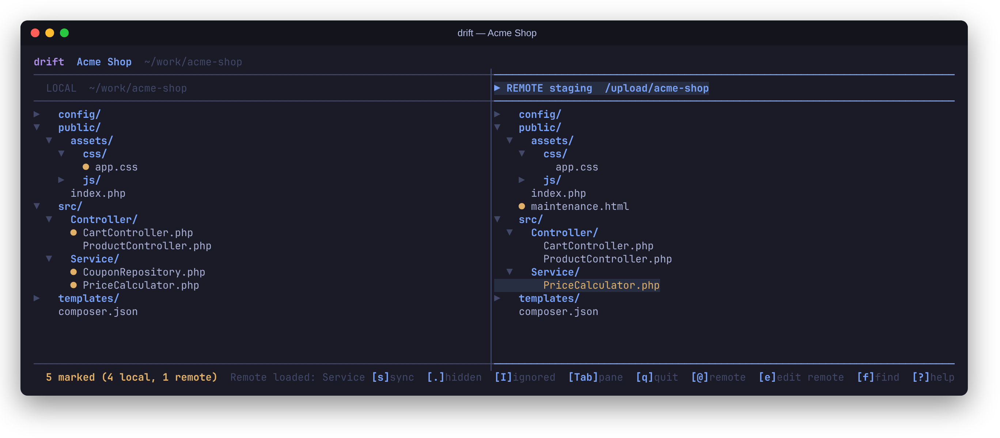
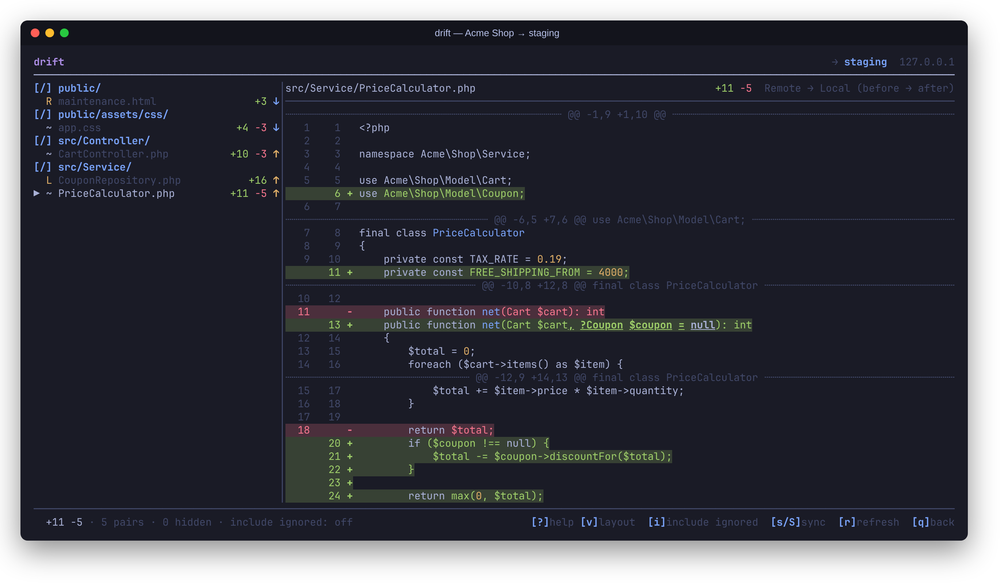
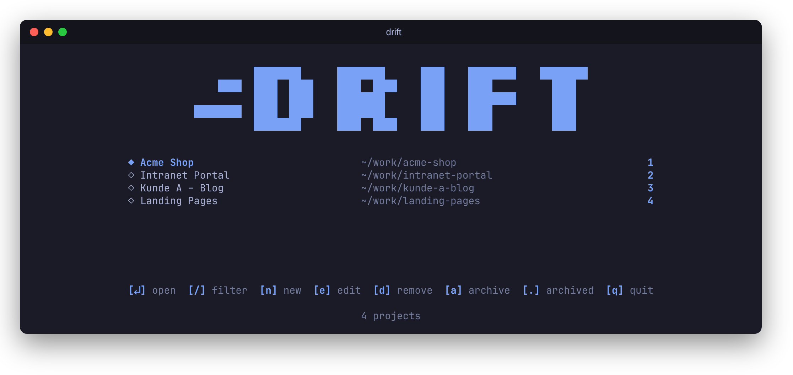

# drift

drift is a terminal app for comparing and syncing a local project with a remote host
over SFTP, FTP or FTPS. It works like PHPStorm's "Browse Remote Host" and "Sync with
Deployed To", but in the terminal. It runs on Linux and macOS.



> [!WARNING]
> drift is in beta. Expect rough edges and breaking changes between releases.

## Features

- Browse local and remote files side by side, preview text files, and mark files or whole directories.
- Compare marked files in a diff view and choose per file whether to upload, download, delete, or skip.
  drift suggests a direction from the modification times.
- Edit a single remote file in your own editor. drift uploads it only after you confirm and checks
  that nobody changed it on the server in the meantime.
- Keep several projects in a dashboard and switch between them without restarting.
- Map local directories to different remote paths per host.
- Share one server's connection and credentials between projects.
- Verify FTPS certificates and trust exceptions per session or permanently.
- Write nothing into your project. Configuration lives in `~/.config/drift/`, and drift respects
  your `.gitignore`.

## Installation

drift needs Go 1.25 or newer to build, and Git at runtime.

```bash
go install github.com/WariKoda/drift@latest
```

Or build from a checkout:

```bash
git clone https://github.com/WariKoda/drift.git
cd drift
make install
```

Both install into `$GOBIN`, or `~/go/bin` when it is unset. That directory must be in your `$PATH`.

## Getting started

1. Run `drift` in your project directory. If the project is not registered yet, drift offers to
   register it; press `y`.
2. Press `H` to open the host manager and `n` to add a host. Enter hostname, user, protocol,
   authentication and the remote root path. In the host list, `t` tests the connection.
3. Back in the browser, mark files or directories with `Space`.
4. Press `s` and choose the host. drift connects and opens the diff view.
5. Check the diffs and the planned action of each file. `Space` changes it.
6. Press `s` to sync the current file or `S` to sync all of them.



`@` connects the right-hand pane to a host so you can browse remote files without syncing.
Press `?` on any screen for its key bindings.

### Projects

drift keeps a registry of your projects. `P` in the browser switches between them, and `drift dash`
opens the dashboard where you add, edit and archive them.



```bash
drift                  # current directory, last project, or the dashboard
drift open acme-shop   # open a registered project by name or slug
drift projects list    # list, add, edit, archive or remove projects
```

### Common keys

| Key | Action |
| --- | --- |
| `Space` | Mark a file or directory (browser), change the sync action (diff view) |
| `s` / `S` | Open the diff view for marked files (browser); sync the current / all files (diff view) |
| `Tab` | Switch between local and remote pane, or the next file in the diff view |
| `@` | Connect the remote pane to a host |
| `p` | Preview the current file in the other pane |
| `e` | Edit the current remote file in your editor |
| `f` | Find files in the project and mark them |
| `H` / `P` | Host manager / project switcher |
| `?` | Help for the current screen |
| `q` | Back, or quit |

## Configuration

drift creates and edits the configuration through its forms, so you rarely need to touch the files:

| File | Contents |
| --- | --- |
| `~/.config/drift/config.toml` | global servers, editor, display settings |
| `~/.config/drift/projects.toml` | the project registry |
| `~/.config/drift/projects/<slug>.toml` | one project's hosts and mappings |
| `~/.config/drift/trusted-certificates.toml` | trusted FTPS certificates |

The host files contain credentials and are created with mode `600`. A password field can hold
`$ENV_VAR` instead of the password itself.

## Documentation

- [Projects and the dashboard](docs/guide/projects.md)
- [Comparing and syncing](docs/guide/sync.md)
- [Editing remote files](docs/guide/remote-editing.md)
- [Key bindings and mouse](docs/guide/keys.md)
- [Configuration reference](docs/guide/configuration.md): hosts, mappings, shared servers,
  keep-alive, FTPS trust, theming, logging

## Upgrading from 0.1.6-alpha or earlier

Older versions stored hosts in `.drift/config.toml` inside the project. Only
[0.1.7-alpha](https://github.com/WariKoda/drift/releases/tag/v0.1.7-alpha) migrates them. Install
it, start it once in each project, then upgrade to the current version. See
[Configuration](docs/guide/configuration.md#upgrading-from-016-alpha-or-earlier) for details.

## Contributing

Issues and pull requests are welcome. See [CONTRIBUTING.md](CONTRIBUTING.md).

The repository also contains a paused native desktop port in [`rust/`](rust/README.md).

## License

MIT, see [LICENSE](LICENSE).
