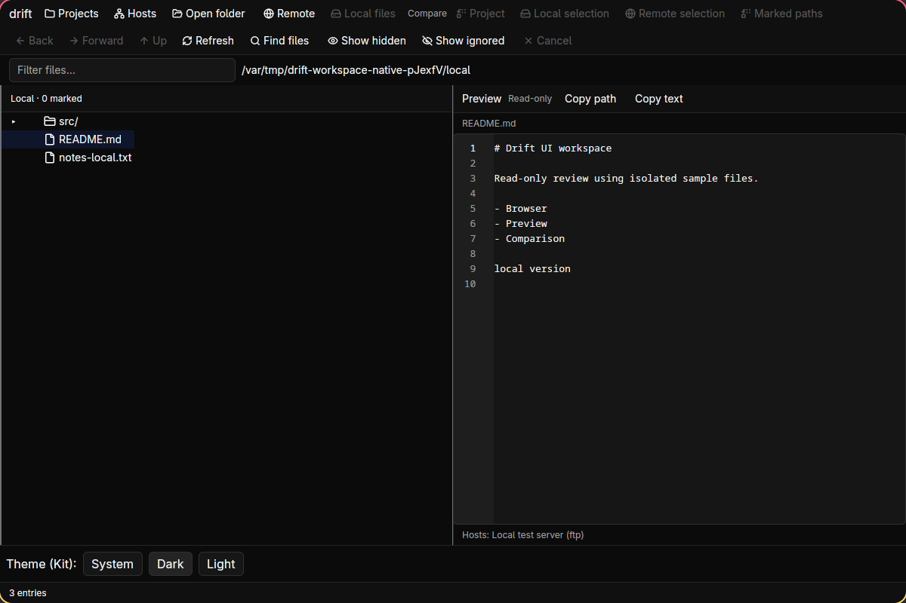
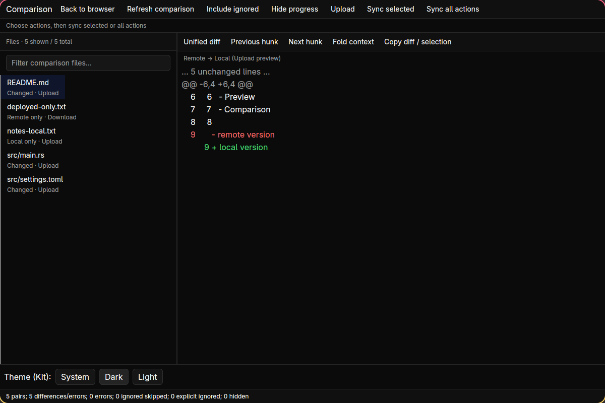
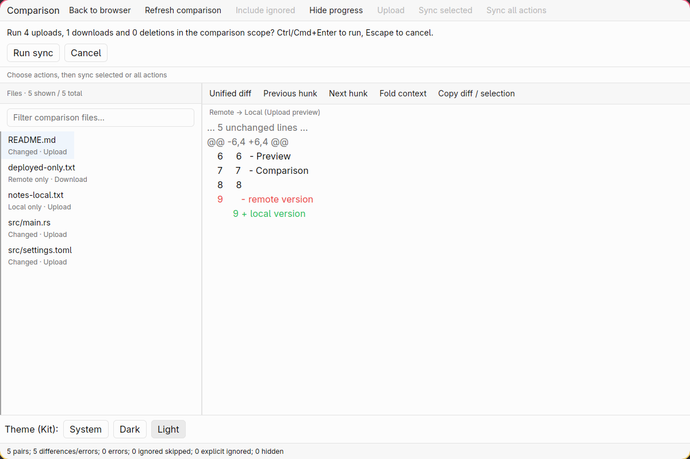
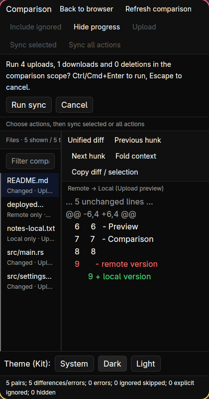

# Hauptarbeitsfläche: begrenzte native Wayland-Prüfung

Stand: **15. Oktober 2026**, Branch `feature/rust-workspace-design`.
Die Prüfung betrifft den uncommitteten Workspace-Designblock, keine öffentliche
Release-Freigabe oder vollständige Plattformabnahme.

## Umgebung und Isolation

- Hyprland 0.56.2, natives Wayland (`xwayland: false`), Monitor 3440×1440, Scale 1.
- Frisch gebautes `rust/target/debug/drift-gui`, SHA-256
  `6a98296ef36399af70631f23157a7f4ea073d155ed90ebe1713fd31198f8be2f`.
- Temporäres HOME, XDG_CONFIG_HOME, Registry und Projekt unter
  `/var/tmp/drift-workspace-native-pJexfV/`; keine realen Projekte oder Zugangsdaten.
- Echter lokaler FTP-Server aus `testdata/ftp-server`, nur auf Loopback, eigene
  temporäre Dateien und bekannte Testauthentifizierung.
- Gezielte virtuelle Tastatur-/Pointer-Ereignisse; aktives Fenster und Ziel-PID
  vor Eingaben geprüft. Aufnahmen enthalten ausschließlich das Testfenster.
  Zusätzliche Schritte wurden bei fehlendem Fokusbesitz durch den Guard beendet;
  daraus wird kein bestandener Bediennachweis abgeleitet.
- Keine Desktop-Konfigurationsänderung. Beide Testprozesse sind beendet;
  ursprünglicher Fensterfokus und Cursorposition wurden wiederhergestellt.

## Beobachtungen

| Ablauf | Ergebnis / Grenze |
| --- | --- |
| Browser/Vorschau, 1200×800 | Kompakte Kopfzeile, getrennte Pfadmetadaten, native Copy-Buttons und schreibgeschützter Editor sichtbar. README über Filter-/Listen-Tastaturroute und `p` geöffnet. |
| Light → Dark bei geladener Vorschau | README-Auswahl und angezeigter Text im erfassten Wechsel erhalten. Kein OS-Systemmodus-/IME-Nachweis. |
| Remote und Vergleich | Lokalen FTP-Testhost über native Buttons verbunden und ganzen Projektvergleich geöffnet: fünf Paare, lokale/entfernte Einzeldateien und geänderte Dateien sichtbar. |
| Vergleich, 1200×800 Dark | Zweizeilige Dateiliste, kompakte Toolbar, Richtung und Unified-Diff sichtbar. Kein neuer visueller Blocker im geprüften Ablauf. |
| Ausstehende Sync-Bestätigung | Plan mit vier Uploads/einem Download geöffnet, ausdrücklich **nicht ausgeführt**. Zusammenfassung steht über Run sync/Cancel. |
| Resize auf 420×800 | Toolbar und Diff-Aktionen umbrechen; Run sync/Cancel bleiben sichtbar. Dateiliste und Diff bleiben sichtbar. Die schmale Dateipane kürzt Pfade/Metadaten; ihre lange Dateizählzeile wird abgeschnitten. Das ist verbleibender responsiver Feinschliff, keine vollständige Schmalfensterabnahme. |
| Dark → Light mit ausstehendem Plan, anschließend 1200×800 | Plan, Dateiliste und Diff bleiben sichtbar; keine automatische Transferausführung. Kein gemessener Kontrastnachweis. |
| Abschluss | Keine FTP-Mutationskommandos (`STOR`, `DELE`, `RNFR`, `RNTO`, `MKD`, `RMD`, `APPE`); Beispielinhalte unverändert. GUI-stderr leer; beide Prozesse beendet. |

## Native Aufnahmen









## Automatisierte Prüfung separat

```sh
cd rust
cargo test --locked --workspace
cargo fmt --all -- --check
cargo clippy --locked --workspace --all-targets -- -D warnings
cargo build --locked -p drift-gui
```

**463 Rust-Tests bestanden, 0 Fehler/Ignore**, darunter drei neue Layout-/Zustands-
Regressionen mit echten Dateien und SFTP. Rustfmt, Clippy und Debug-Build bestanden.
Read-only Folgeprüfung fand keinen handlungsbedürftigen Codeblocker; sie führte
keine eigenen Builds oder Desktoptests aus.

## Weiter offen

- Responsive Hierarchie für sehr schmale Dateipanes, Zähler und Metadaten.
- Visuelle Priorisierung der vielen Toolbaraktionen und klarere Quelle-/Zielkontexte.
- Große Listen, lange native Pfade, HiDPI, andere Fonts/Größen und sehr kurze Fenster.
- Native Diff-Glyph-Hit-Tests, Clipboard/Permissions, echte IME und Accessibility.
- X11 und macOS Intel/Apple Silicon, OS-Themewechsel und Fensterwiederherstellung.
- Host-/Trust-/Verwaltungsdialoge und laufende Transfers waren nicht Teil dieses Checks.

Die SSH-, Monokai-, Paketierungs- und Release-Gates bleiben unverändert offen.

## Folgeblock: Toolbar und schmale Dateipanes

Der anschließend implementierte Stand priorisiert Aufgaben gegenüber Navigation,
trennt Vergleichsoptionen von Planung und misst die tatsächliche Dateipane. Shown-
und Total-Zähler umbrechen separat; Status und Aktion stehen unter 240 skalierten
Breitenpixeln untereinander. Native Textmessung bemisst die einheitliche Row-Höhe
für alle möglichen Status-/Aktionslabels. Auch bei gleichzeitig ausstehender
Nearest-Navigation bleibt der relative Dateiscroll-Anker erhalten. Dieser Fix und
seine Regression korrigieren einen im Folge-Review gefundenen Scroll-Sprung.

**Automatisiert:** 464 Rust-Tests, 0 Fehler/Ignore; Rustfmt, striktes Workspace-/
All-target-Clippy und GUI-Debug-Build bestanden. Der zusätzliche reale SFTP-Fall
prüft 63 Dateipaare, 120-Pixel-Panes auch bei breitem Fenster, Fonts 16/24/32,
native Wrapped-Line-Maße und Paint-Clips, Filterzähler, Auswahl/Entities und den
Scroll-Anker mit vorgemerkter Navigation. Für die vergrößerte Typografie wird ein
2000 Pixel hoher Headless-Viewport verwendet; daraus folgt keine Abnahme kleiner
Fensterhöhen. Der Toolbar-Test prüft weiterhin alle 17 nativen Aktionen, inklusive
Disabled-Inertheit und vollständiger unveränderter Tab-Reihenfolge.

Ein zusätzlicher Filtertest verwendete zunächst `InputState::set_value`, das
absichtlich kein Change-Ereignis emittiert; sein wartender Lauf wurde nach 300
Sekunden beendet. Der korrigierte Test verwendet native Filter-Fokussierung und
Texteingabe. Die abschließende Gesamtprüfung ist danach vollständig bestanden;
kein Timeout wurde dafür verlängert und kein Test übersprungen.

**Native Wiederholung offen:** Ein isolierter Start des neuen Debug-Builds unter
`/var/tmp/drift-workspace-responsive-native-QGy5Uy/` bekam trotz zielgerichteter
Compositor-Fokusanforderung keinen bestätigten aktiven Fensterbesitz. Der Guard
verhinderte deshalb Tastatur-/Klick-Eingaben und Aufnahmen. GUI und lokaler
FTP-Testserver wurden geschlossen; beide Prozesse sind beendet, GUI-stderr ist
leer. Es gibt **keine neuen Screenshots oder native Freigabe** für diesen Stand.
Die Aufnahmen oben dokumentieren ausschließlich den früheren ersten Durchgang.

Der gebaute Folge-Stand hat SHA-256
`18409c82cf51099a820f7f827b2919b3879696725c420d6699be8f538a512d44`.
Native erneute Abnahme, andere Plattformen und sämtliche Release-Gates bleiben offen.

## Nutzerfeedback: fester Rahmen und Browsernavigation

Nach der manuellen Begutachtung des vorigen Builds wurde die Toolbar aus dem
Browserinhalt in die äußere Shell verschoben. Sie bleibt auch über Projects,
Hosts, Vergleich und Sicherheitsansichten sichtbar. Die acht gewünschten
Browseraktionen verwenden nur Icons, mit vollständigen Tooltips/A11y-Labels.
Zusätzlich sind Vorfahren in lokaler/entfernter Pfadleiste anklickbar und native
Maus-Zurück/Vorwärts-Ereignisse pane-eigen an die vorhandene Historie gebunden.
Ansichts-, Draft-, Write-, Busy-, Root- und Stale-Guards bleiben verbindlich.

Frische vollständige lokale Prüfung: **476 Rust-Tests bestanden, 0 Fehler/Ignore**,
Rustfmt, striktes Workspace-/All-target-Clippy und GUI-Debug-Build bestanden.
Reale Datei-/SFTP-/FTP-Fälle prüfen Pfadziele, Grenzen, Historie, Unicode/Bytepfade,
Modalsperren und Zustandserhalt. Der Toolbar-Shortcut-Kontext ist eigens abgesichert:
F5, Ctrl/Cmd+F und Ctrl+Esc dürfen bei Buttonfokus funktionieren, aber nicht auf
einen verdeckten Browser durchgreifen.

Debug-Binary SHA-256:
`26623704ffac9813b357bded7daa61b7de47485a4591c60f6747e164c51f128d`.
Die zuvor laufende Nutzer-App wurde während der Implementierung nicht bedient,
geschlossen oder ersetzt. **Keine neue native Sichtabnahme oder Aufnahme** für
diesen Build; die Bilder oben bleiben Nachweise ausschließlich des ersten Stands.
